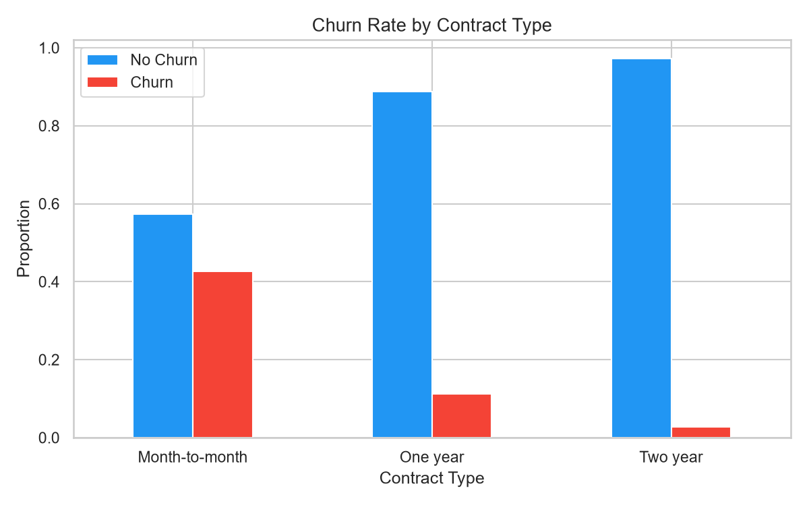
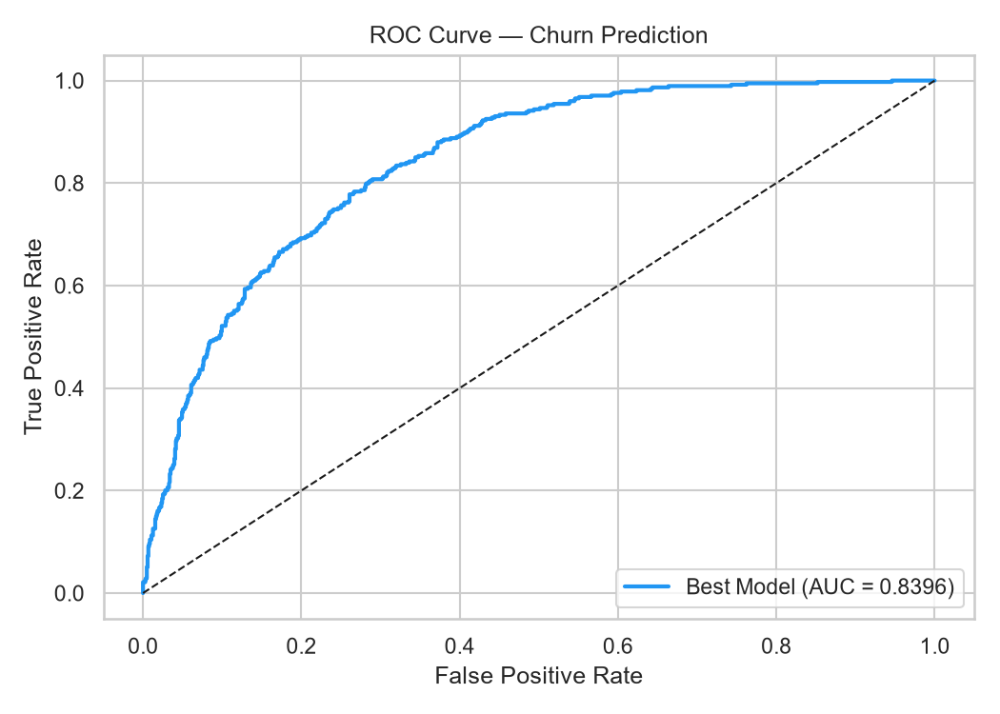
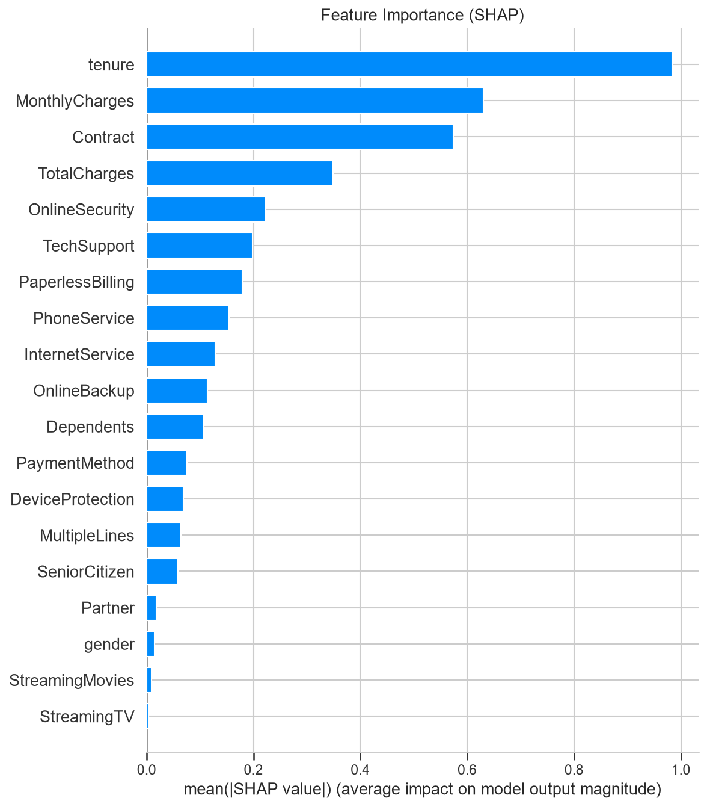

# ChurnSight: Telco Customer Churn Prediction

**Live demo:** [churnsight-mustafa.streamlit.app](https://churnsight-mustafa.streamlit.app)

An end-to-end churn prediction project: exploratory analysis, model benchmarking, SHAP explainability, decision-threshold tuning, and an interactive Streamlit app that scores customers by churn risk.

## Business problem

A telecom company loses recurring revenue every time a customer cancels. The goal is to flag customers likely to churn **before** they leave, so the retention team can step in.

## Dataset

- Source: [Telco Customer Churn, IBM sample dataset on Kaggle](https://www.kaggle.com/datasets/blastchar/telco-customer-churn)
- 7,043 customers × 21 features
- Target: `Churn` (Yes/No), 26.5% positive class

## Approach

### 1. Exploratory data analysis
Three hypotheses were tested against the data:

| Hypothesis | Result |
|---|---|
| Customers without TechSupport/OnlineSecurity churn more | ✅ Confirmed: 41.8% vs 15.2% churn rate |
| Higher MonthlyCharges correlate with churn | ✅ Confirmed: churners pay $74.44/mo vs $61.27/mo |
| New customers (low tenure) churn more | ✅ Confirmed: median churner tenure is 10 months vs 38 months |

**Contract type is the strongest categorical predictor.** Month-to-month customers churn at 42.7%, two-year contract customers at 2.8%.



### 2. Preprocessing
- Converted `TotalCharges` to numeric (11 blanks imputed with the median)
- Label-encoded categorical features
- Stratified 80/20 train/test split
- `StandardScaler` fit on the training set only, so there's no data leakage

### 3. Modeling

| Model | Accuracy | Recall (churners) | ROC-AUC |
|---|---|---|---|
| **Logistic Regression** | 80% | 0.55 | **0.8403** |
| Random Forest | 79% | 0.50 | 0.8216 |
| XGBoost | 79% | 0.54 | 0.8220 |

Logistic Regression beat both tree models on ROC-AUC. That fits the EDA: the churn drivers here are largely linear and monotonic.

The decision threshold was then tuned from 0.50 down to **0.40**, to catch more churners at an acceptable precision cost. Missing a churner costs more than a wasted retention offer.



### 4. Explainability (SHAP)
The top churn drivers are **tenure**, **monthly charges**, **contract type**, **total charges** and **online security**. Gender and streaming services have near-zero impact.



### 5. Business impact (test set, 1,409 customers)
- The model correctly identified **205 of 374 churners**
- Assuming a retention campaign saves 30% of flagged customers, the estimated revenue saved is **about $47K/year** on the test set, or about $237K/year across the full customer base

## Key takeaways
- A simple Logistic Regression beat XGBoost here. More complexity isn't always better.
- The first 12 months are the highest-risk window.
- Contract type is the most actionable lever: pushing customers toward longer contracts targets the biggest churn gap.

## The app (ChurnSight)
A Streamlit app that loads the trained model, scores a customer's churn probability with the tuned 0.40 threshold, explains the main risk signals, suggests retention actions, and shows how each action would change the score.

## Run it locally

```bash
git clone https://github.com/mustafa-amjad/telco-churn-prediction.git
cd telco-churn-prediction
python -m venv venv
venv\Scripts\activate          # Windows  (macOS/Linux: source venv/bin/activate)
pip install -r requirements.txt
streamlit run app.py
```

To retrain, install `requirements-notebook.txt` and open `notebooks/01_EDA_and_modeling.ipynb`.

## Project structure

```
telco-churn-prediction/
├── app.py                         # Streamlit UI (ChurnSight)
├── churn/model.py                 # encoding, scoring, risk rules, what-if
├── data/                          # raw IBM Telco dataset
├── model/                         # trained model, scaler, feature names, threshold
├── notebooks/
│   └── 01_EDA_and_modeling.ipynb  # EDA, modeling, SHAP, threshold tuning
├── outputs/                       # charts used in this README
├── requirements.txt               # app dependencies
├── requirements-notebook.txt      # notebook dependencies
└── LICENSE
```

## Tech stack
Python · pandas · scikit-learn · XGBoost · SHAP · Matplotlib · Seaborn · Plotly · Streamlit

## Author
**Mustafa Amjad**, Data Scientist / AI Engineer · [LinkedIn](https://www.linkedin.com/in/mustafaamjad9)

MIT License
